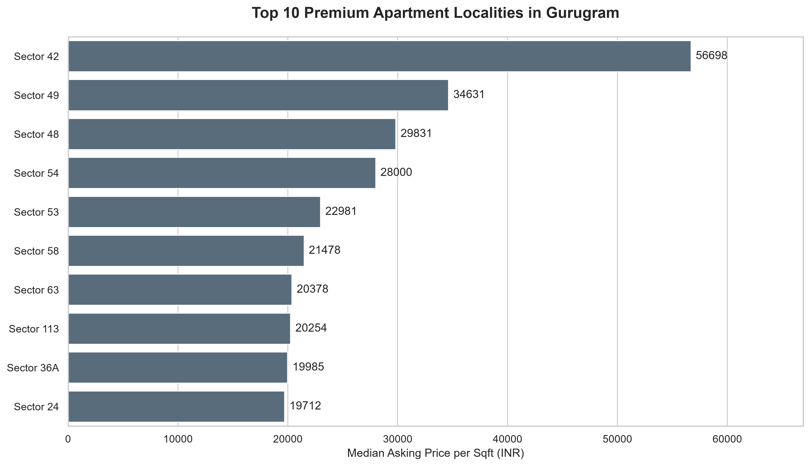
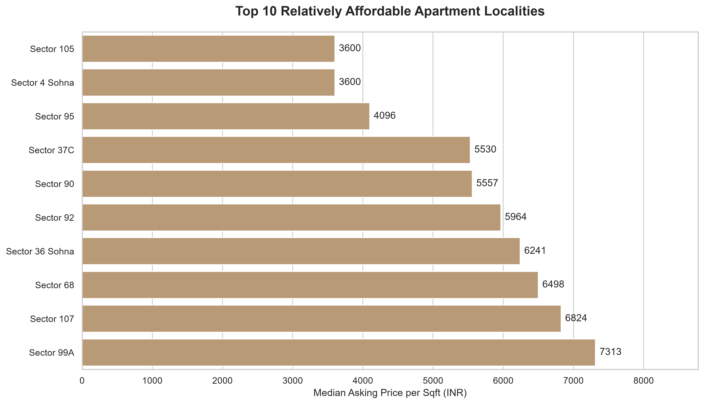
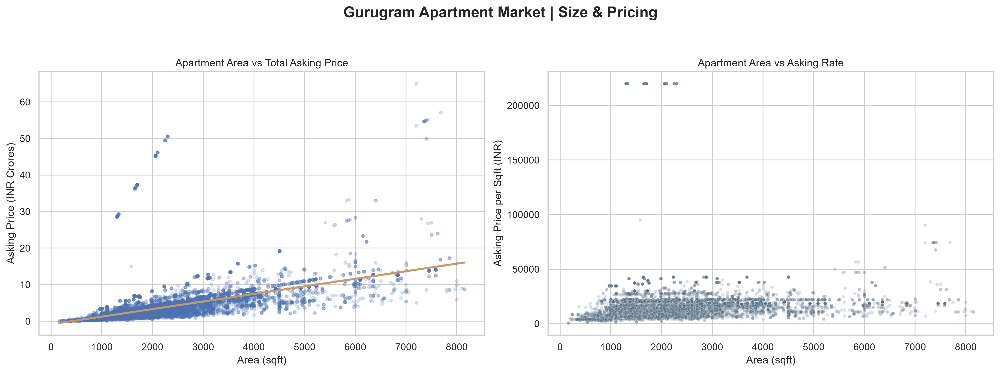
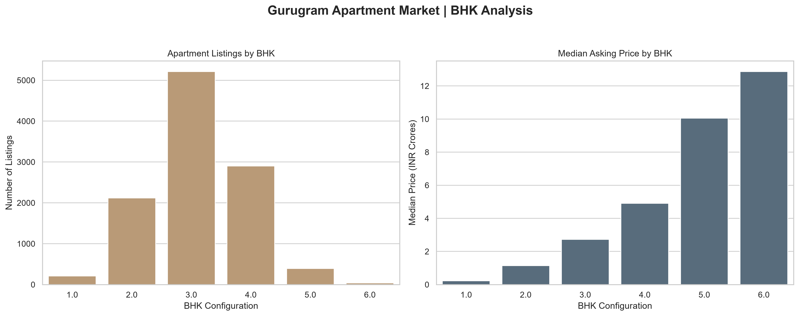

# Gurugram Real Estate | Listing Price Analysis

An exploratory analysis of residential property listings in Gurugram, built with Python, pandas, Matplotlib and Seaborn. The focus is on **asking-price differences across localities and property types**, alongside checks for suspicious or inconsistent listing data.

## Questions explored

- Where are apartment asking rates highest and lowest?
- How strongly is apartment size associated with total asking price and price per square foot?
- Which BHK configurations appear most often in the listings?
- How do advertised prices differ by RERA label and construction status?

## Selected findings

| Measure | Result |
| --- | --- |
| Listings in the original analysis | 14,223 |
| Most common property category | Apartment (11,000 listings) |
| Highest median apartment asking rate among eligible localities | Sector 42 — ₹56,698/sqft (59 listings) |
| Lowest median apartment asking rate among eligible localities | Sector 105 and Sector 4 Sohna — ₹3,600/sqft |
| Most common qualifying apartment layout | 3 BHK — 5,214 listings |
| Spearman correlation: apartment area vs total asking price | 0.797 |
| Spearman correlation: apartment area vs asking rate/sqft | 0.378 |

The apartment comparisons use listings with consistent price and area information. Locality rankings require at least 20 qualifying apartment listings. These results describe **this dataset**, not the entire Gurugram housing market.

## Charts

### Apartment pricing by locality





### Size and price



### BHK mix



Additional figures: [market overview](reports/figures/market_overview.png) · [RERA and property status](reports/figures/rera_status_analysis.png)

## Approach

1. Standardized column names, categorical values and numeric fields.
2. Checked duplicate rows, extreme areas/BHK counts, invalid values and price-per-square-foot consistency.
3. Separated the complete cleaned data from the subset used for rate comparisons. Records with over 10% discrepancy between advertised and calculated price/sqft were flagged and excluded from rate-based analysis.
4. Used medians for group comparisons to reduce the influence of extreme asking prices; kept sample sizes visible.
5. Used Spearman rank correlation to explore associations between size and pricing.

## Run locally

Python 3.14 was used during development.

```bash
python -m pip install -r requirements.txt
python main.py
```

The script reads the CSV from `data/raw/`, writes cleaned data to `data/processed/`, and regenerates the figures under `reports/figures/`.

## Repository layout

```text
data/raw/            original listing data
data/processed/      cleaned and rate-analysis exports
reports/figures/     charts used in this report
reports/findings.md  interpretation and caveats
main.py              cleaning, checks and exploratory analysis
requirements.txt     Python dependencies
```

## Caveats

These are advertised **asking prices**, not verified sales. Listing coverage, repeated advertisements, project mix and location differences can bias comparisons. The RERA field reflects labels in the source data, not independently checked regulatory status. The correlation results do not establish causality. Some extreme asking rates still require manual verification even after arithmetic checks.
